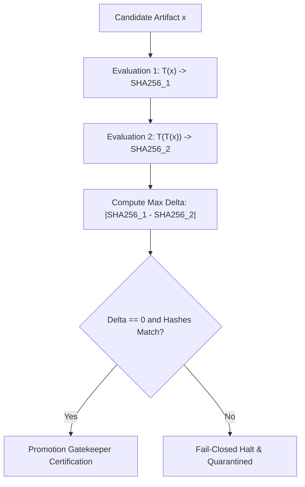

# Deterministic Idempotent Promotion Workflow

## Purpose
Enforce strict mathematical determinism and idempotence ($\mathcal{T}(\mathcal{T}(x)) = \mathcal{T}(x)$) with cryptographic SHA-256 validation across all models, notebooks, and pipelines prior to deployment or promotion.

## Trigger
- Before creating a PR or landing code into `main`
- Before submitting solutions to Kaggle
- As a gating step in automated CI/CD

## Validation Protocol



## Step-by-Step Instructions

1. **Run Proof Suite**:
   Execute the automated idempotence verification script:
   ```bash
   python3 scripts/testing/prove_deterministic_idempotence.py
   ```

2. **Verify Cryptographic Digests**:
   Verify that all 6 test domains pass with exact SHA-256 match and $\Delta_{\max} = 0.00\text{e}+00$:
   - Domain 1: Poincaré Ball Boundary Projection
   - Domain 2: Nelder-Mead Copula Optimization
   - Domain 3: Adversarial Validation
   - Domain 4: Synthetic Procedural AST Compilation
   - Domain 5: Dead-End Ledger Linter
   - Domain 6: Two-Party Adversarial IV&V

3. **Check Promotion Transparency Log**:
   Inspect TransparencyLog to ensure no unsigned artifacts are dispatched:
   ```python
   from cohezion.authority import IVVPolicy
   policy = IVVPolicy()
   assert policy.verify_artifact_integrity("path/to/artifact")
   ```

4. **Fail-Closed Guarantee**:
   Any deviation $\Delta_{\max} > 0.0$ or digest mismatch automatically aborts promotion and records a critical anomaly to the EventBus.
