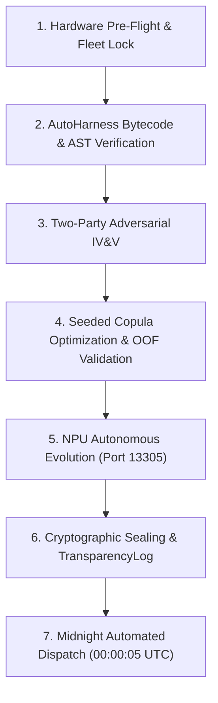

# Kaggle Offline Ascension & Quota Maximization Workflow

## Purpose
Execute continuous, zero-idle local computation between Kaggle submission resets without breaching hardware limits or UMA aperture constraints, automatically preparing and promoting verified SOTA candidates.

## Trigger
- Scheduled execution (between 00:00 UTC resets)
- Post-submission idle windows
- Manual trigger: `bash scripts/kaggle/run_offline_ascension.sh`

## Prerequisites
- Zen 5 CPU (32 threads) available for compilation, validation, and Copula optimization.
- AMD XDNA 2 NPU active on port 13305 (FastFlowLM SRAM execution, 0 GiB UMA impact).
- Fleet sentry running (`scripts/fleet_sentry.py`).

## Workflow Steps



### Step 1: Hardware Pre-Flight & Somatosensory Sampling
Sample 12D proprioceptive vector and verify available memory:
```bash
python3 -c "from cohezion.cybernetics.proprioceptive_sensor import ProprioceptiveSensor; s = ProprioceptiveSensor(); print(s.sample())"
```
Ensure available RAM $\ge 24\text{ GiB}$, Swap == 0, GTT aperture load $< 10\text{ GiB}$.

### Step 2: AutoHarness Zero-Cost Bytecode Verification
Run the dead-end ledger and AST forbidden-subgraph linter over candidate notebooks:
```bash
python3 src/cohezion/registry/forbidden_subgraphs.py
```

### Step 3: Two-Party Cryptographic IV&V Gate
Verify candidate notebooks with independent red-team adversary:
```bash
python3 scripts/testing/prove_deterministic_idempotence.py
```

### Step 4: Seeded Copula Optimization & OOF Validation
Optimize ensemble weights deterministically across out-of-fold predictions using Nelder-Mead with fixed seed.

### Step 5: NPU Background Evolution
Dispatch candidate prompt mutation and invariant discovery to the local NPU daemon on port 13305:
```bash
curl -s http://127.0.0.1:13305/v1/chat/completions \
  -H "Content-Type: application/json" \
  -d '{"model": "llama3.2-1b-FLM", "messages": [{"role": "user", "content": "Analyze ARC invariant"}]}'
```

### Step 6: Cryptographic Sealing & Promotion
Generate dual attestation with `IVVPolicy` and sign into TransparencyLog.

### Step 7: Automated Kaggle Dispatch
When the quota resets at 00:00:05 UTC, submit via `scripts/kaggle/kaggle_submit.py`:
```bash
python3 scripts/kaggle/kaggle_submit.py notebook -c <competition> -k <kernel_name> -m "Cohezion SOTA v<N>"
```
