# Proprioceptive Cybernetic Feedback Loop Workflow

## Purpose
Enforce real-time multi-level biological cybernetics across all Cohezion agent loops: muscle spindle damping, Golgi tendon organ tensile protection, corollary discharge efference verification, and variable mechanical impedance.

## Trigger
- System startup (`fleet_sentry.py` launch)
- Agent code generation / refactoring execution
- Hardware stress alerts

## Cybernetic Hierarchy

```mermaid
flowchart TD
    subgraph Loop0["Loop 0: Spinal Mechanoreceptor (<1ms)"]
        GTO["GTO Tensile Stress"] --> Reflex["Rate Reflex: t_cross = (M - Floor) / |dM/dt|"]
        Reflex --> Shed["Autogenic Inhibition: Drop Threads"]
    end
    subgraph Loop1["Loop 1: Musculoskeletal Damping (10-50ms)"]
        Spindle["Muscle Spindles (AST Velocity dL/dt)"] --> Damp["Critical Damping (zeta >= 0.707)"]
        Damp --> AST["Constrain Mutation Delta"]
    end
    subgraph Loop2["Loop 2: Cerebellar Efference Copy (100-500ms)"]
        Action["Action Ticket Hat_S"] --> Sensory["Sensory Return S"]
        Sensory --> Residual["Compute Residual delta_eff"]
        Residual --> Gate["delta_eff > theta -> Microsecond Halt"]
    end
    subgraph Loop3["Loop 3: Autopoietic Learning (Seconds-Minutes)"]
        Retrospective["Retrospective Extraction"] --> Surreal["SurrealDB learning Table"]
        Surreal --> Obsidian["Obsidian Vault 01-Learnings"]
    end
```

## Operational Guidelines

1. **Loop 0 Isolation**:
   - The crossing-time rate reflex must evaluate synchronously in `<1 ms`.
   - Never use `await`, network calls, or database writes inside the reflex handler.
   - Journaling is dispatched asynchronously after load shedding.

2. **Loop 1 Damping**:
   - When mutating code files, compute the AST edit distance and line velocity $\dot{L}$.
   - Reject single-pass rewrites exceeding 400 lines without modularization.

3. **Loop 2 Efference Verification**:
   - Issue predicted impact ticket before dispatching large batch operations.
   - If memory or execution time deviates by $>50\%$ from the ticket, pause the pipeline and re-evaluate.

4. **Loop 3 Recursive Self-Improvement**:
   - On completion of each loop iteration, log findings to SurrealDB `learning` table and generate corresponding markdown notes in `~/vaults/cohezion-vault/01-Learnings/`.
