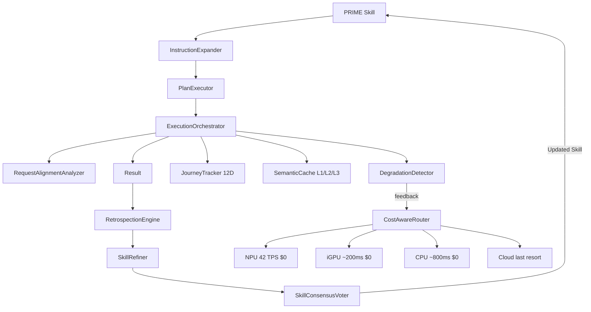

<div align="center">


# Cohezion

[](https://github.com/manderson240/cohezion/actions/workflows/ci.yml)
[](https://github.com/manderson240/cohezion/actions/workflows/codeql.yml)
[](https://github.com/manderson240/cohezion/actions/workflows/security-scan.yml)
[](https://www.python.org/downloads/)
[](LICENSE)
[](https://www.amd.com/en/products/processors/consumer/ryzen/ai.html)

**The compound AI engine built to get smarter every session** — and the [measurement](docs/benchmarks/compound_loop/README.md) that checks whether it does.

Cohezion is an open-source platform for compound AI orchestration — a self-improving loop where 182 version-controlled skills compound across sessions, agents learn inside a physics-grounded 12D manifold, and the entire inference stack runs locally on AMD hardware with **no per-token API costs**.

[Quick Start](#quick-start) · [Architecture](#architecture) · [Local Inference](#local-inference-stack) · [Benchmarks](#training-results) · [Contributing](#contributing)

</div>

---

## Why Cohezion?

| Other AI Frameworks | Cohezion |
|---|---|
| Each session starts fresh | **Skill files persist across sessions and the loop can refine them** — whether that compounds is [measured, not assumed](docs/benchmarks/compound_loop/README.md) |
| Assumes NVIDIA GPU | **AMD-first**: XDNA2 NPU (42 TPS) + iGPU + CPU, no CUDA |
| Cloud API = cost per token | **No per-token API fees** — local inference via the Lemonade router at `:13305` |
| Safety = penalty terms in reward | **Safety = physics** — the Lagrangian attractor makes unsafe actions fight the dynamics |
| Agent coordination is ad-hoc | **HIHO equilibrium** — six mathematical frameworks converge at coherence = 0.5 |
| Manual knowledge management | **Self-improving loop** — SkillRefiner version-bumps skills from execution results |

---

## Quick Start

At its core Cohezion ships a [Gymnasium](https://gymnasium.farama.org/)-compatible training
environment plus the tooling to train, evaluate, and reproduce agents in it — all of
it CPU-friendly and CUDA-free:

```bash
git clone https://github.com/manderson240/cohezion.git && cd cohezion
uv sync  # installs all deps

# 60-second tour: step an agent through the 12D manifold (no network, no GPU)
uv run python examples/quickstart.py

# Validate the compound engineering loop (50+ checks, seconds)
make validate

# Train a PPO agent on the 12D manifold (20K steps, ~5 min)
uv sync --extra rl && make train
```

**Requires**: Python 3.13+, [uv](https://github.com/astral-sh/uv).
Installs from source only (not yet on PyPI); GPU extras pin AMD ROCm wheels — see
[`docs/tutorials/`](docs/tutorials/) for a guided setup.

---

## Key Capabilities

### Self-Improving Compound Loop

Every execution extracts learnings that refine the skill definitions agents use next time:

```
Execute (CompoundExecutor 11-step pipeline)
  → Reflect  (RetrospectionEngine extracts non-obvious patterns)
  → Refine   (SkillRefiner version-bumps the PRIME skill)
  → Compound (better skill → smarter next execution)
```

182 PRIME skill definitions in [`src/cohezion/skills/`](src/cohezion/skills/) are the accumulated output of 100+ development sessions — version-controlled, keyword-indexed, and auto-discoverable. Run the cycle: `uv run python scripts/drivers/compound_cycle.py`

**Does the loop actually compound?** [`docs/benchmarks/compound_loop/`](docs/benchmarks/compound_loop/README.md) is a three-arm, falsifiable test of exactly that: refinement on, skill frozen, and a placebo that grows the skill by the same number of sections with untargeted text, all on the local NPU at temperature 0. Committed run (2026-10-23, `llama3.2-1b-FLM`, 1B parameters, 15 scored tasks, 4 of 6 planned sessions, promotion gates fail-open): pooled pass rate over measured sessions **0.88 with refinement, 0.92 with placebo, 0.50 frozen**. Growing the skill file helps this small model under its token cap; the refiner's content showed no advantage over the placebo, so the compounding claim is **not supported by this run** (underpowered, so not refuted either; the write-up lists every caveat). The benchmark also found and fixed the reason refinements never reached a prompt before. Reproduce: `uv run python scripts/experiments/compound_loop_evidence.py --model llama3.2-1b-FLM --max-tokens 96 --sessions 6`.

---

### Physics-Grounded Agent Safety


Instead of adding penalty terms to reward functions, Cohezion shapes the environment dynamics so unsafe behavior works against the physics. Agents operate inside a 12D Riemannian manifold governed by:

- **Lagrangian dynamics** — large unsafe actions fight the Lagrangian attractor (self-correcting)
- **SU(2) gauge theory** — flat connection = Yang-Mills vacuum = HIHO equilibrium
- **Bioelectric percolation** — Levin-inspired gap junction network distributes coherence across agents
- **Fisher information metric** — connects FLUME latent space, manifold geometry, and thermodynamics

**Result** (from our 8-run diagnostic, reproducible via `make benchmark`): a random agent shows ~40% safe behavior without any training — the physics guides it — and PPO trained with the Lagrangian attractor reaches **0.9+ coherence** without explicit safety constraints.

---

### Multi-Agent Swarm with Cost-Aware Routing


Specialist sub-agents collaborate through the compound engineering pipeline. Cost-aware routing sends 70% of requests to local silicon ($0), 20% to mid-tier, and only 10% to high-cost models:

```python
from cohezion.compound import make_executor

executor = make_executor(mcp_client)  # wires Lemonade → SemanticCache → CompoundExecutor
result = await executor.execute_task("Your task here")
```

The semantic cache (L1 exact hash + L2 cosine similarity + L3 vault) short-circuits repeat prompts before any model call. Its L2 threshold is tuned by [`scripts/calibration/run_cache_calibration.py`](scripts/calibration/run_cache_calibration.py); no hit-rate figure is published here because none has been measured on a committed, reproducible workload yet.

---

## Architecture



### Module Map

| Layer | Module | Entry Point |
|---|---|---|
| **Compound Loop** | `compound/` — Executor, SkillRefiner, RetrospectionEngine, JourneyTracker | `CompoundExecutor` |
| **Swarm** | `swarm/` — TeamOrchestrator, CostAwareRouter, OI-MAS scoring | `CostAwareRouter` |
| **Semantic Cache** | `cache/` — L1 hash + L2 cosine + L3 vault | `SemanticCache` |
| **Physics Engine** | `physics/` — SU(2) spinors, Lagrangian, fiber bundles, gauge theory, cosmogony | `SpinorState` |
| **RL Environments** | `environments/` — ManifoldEnv (19D obs), SwarmEnv (multi-agent gauge coupling) | `gym.make('Cohezion/ManifoldEnv-v0')` |

The `info` dict returned by `ManifoldEnv.reset()` / `step()` carries these keys (see the class and `step()` docstrings in `src/cohezion/environments/manifold_env.py` for the authoritative, fully-specified list):

| Key | Meaning |
|---|---|
| `coherence` | current coherence (1.0 = HIHO safe equilibrium) |
| `avg_coherence` | running episode average |
| `invariant_passed` / `invariant_failed` | physics-invariant check counts (only present when the optional `InvariantChecker` is active; absent otherwise) |
| **World Model** | `world_model/` — JEPA predictor (86K params), bioelectric network, EVO model | `JEPAWorldModel` |
| **FLUME VAE** | `flume/` — 256D thought vectors, PolarQuant (2.7x compression), QJL (32x) | `ThoughtEncoder` |
| **Knowledge** | `ouroboros/` + vault — Mycelium transport, SurrealDB, Obsidian | `OuroborosBridge` |
| **API** | `api/` — FastAPI backend, AG-UI event streaming (15+ typed SSE events) | `uvicorn cohezion.api:app` |
| **Genesis UI** | `src/web/` — Next.js 16, Three.js Bloch sphere, swarm topology viz | `/genesis` route |

---

## Local Inference Stack

Cohezion runs its entire inference pipeline on AMD silicon — no NVIDIA, no cloud required:

```
Lemonade Router :13305  (single endpoint for the full model catalog)
│
├── NPU  — llama3.2-1b-FLM      42 TPS  │ classification, routing, short answers
├── iGPU — Gemma-4-E4B-it-GGUF  ~200ms  │ code gen, structured output
└── CPU  — DeepSeek-Qwen3-8B     ~800ms  │ reasoning, multi-step analysis
```

Routing is automatic — cheap tiers first, escalate only when quality gates fail:

```python
from cohezion.inference.triune_orchestrator import build_triune_orchestrator
from cohezion.compound import make_executor

executor = make_executor(mcp_client, provider=build_triune_orchestrator())
```

**Hardware**: AMD Strix Halo — Ryzen AI MAX+ 395 (16C/32T, XDNA2 NPU), Radeon 8060S (iGPU), 128 GiB LPDDR5X unified memory. No CUDA. No NVIDIA tax.

Check availability: `curl -s http://localhost:13305/v1/models`

---

## Training Results

The physics and RL layers stand alone — you can train agents in the manifold without ever
touching the compound loop. An 8-run diagnostic across the 2×2 algorithm-reward matrix
(PPO/SAC × curriculum/dense). Reproduce with `make train` (20K steps, ~5 min) or
`make benchmark` (100K steps):

| Algorithm | Reward Mode | Steps | Reward | vs Random | vs Greedy |
|---|---|---|---|---|---|
| PPO | curriculum | 100K | 14.23 | +7.51 | +1.34 |
| **SAC** | **dense** | **100K** | **40.77** | **+3.40** | **-1.20** |
| PPO | dense | 100K | 38.95 | -1.79 | +3.73 |

**Best**: SAC + dense reward, 100K steps. SAC's off-policy replay cooperates with the Lagrangian attractor; dense reward gives simpler gradients than curriculum at scale.

Checkpoint: `data/rl/checkpoints/policy_final.pt`

---

## The HIHO principle

HIHO (Half-In, Half-Out) — coherence = 0.5 — is where six mathematical frameworks independently converge to the same stable equilibrium:

1. **Brahmagupta (628 CE)**: deviation = coherence − 0.5 = 0
2. **Friston Free Energy**: F = E − TS minimization
3. **Yang-Mills gauge theory**: flat connection at HIHO vacuum
4. **Fisher information metric**: natural gradient minimum
5. **Bloch sphere equator**: (|↑⟩ + |↓⟩)/√2 superposition
6. **Landau phase transition**: order parameter at critical temperature

This convergence is not a coincidence — it is the mathematical structure of stable complex systems. HIHO is the attractor. Implementation: [`src/cohezion/physics/cosmogony.py`](src/cohezion/physics/cosmogony.py)

---

## Agentic-First Development

Cohezion is built **by** agents, not just **for** agents. The 182 PRIME skill definitions are the compounded output of 100+ agentic development sessions.

The [CLAUDE.md](CLAUDE.md) agent contract is inherited by every sub-agent spawned on this repo. It encodes patterns discovered in production:
- **Deferred tool loading** — load `SendMessage` schema before calling it, or it raises `InputValidationError`
- **Vault-first knowledge** — all learnings go to `~/vaults/cohezion-vault/`, not inline comments
- **Post-formatter re-read** — ruff reformats files in place; re-read before the next `Edit`
- **Inference routing** — port `:13305` (Lemonade) serves NPU/iGPU/CPU on demand

The full agent contract, specialist routing table, and coding standards live in
[CLAUDE.md](CLAUDE.md) — start there if you develop with an AI coding agent.

---

## Verify it yourself

Three commands, no credentials. The first two run offline in under a minute; the third needs the local Lemonade router at `:13305` and takes a few minutes (the full benchmark it gates takes 30-60 minutes on an idle NPU).

```bash
uv run python examples/quickstart.py
# -> 10 ManifoldEnv steps, "episode summary: 11 positions visited", then
#    "Quickstart complete. No network, credentials, or local inference were used." (exit 0)

make validate
# -> one "[PASS] ..." line per compound-loop check and "Completed in N s", exit 0
#    (the SurrealDB and vault checks report their own status; a missing service is a visible line, not a crash)

uv run python scripts/experiments/compound_loop_evidence.py --calibrate --models llama3.2-1b-FLM --max-tokens 96
# -> per-task +/- lines and "[calibrate] llama3.2-1b-FLM max_tokens=96: pass=... -> IN BAND"
#    The committed calibration measured 0.625; this backend is not bit-reproducible at temperature 0,
#    so expect roughly 0.4-0.7. Add --model llama3.2-1b-FLM --sessions 6 (without --calibrate) for the
#    full three-arm run; it exits 1 when the claim is not supported, which is the committed result.
```

## Development

```bash
make format      # ruff format
make lint        # ruff check + auto-fix
make test        # 12,000+ test suite
make validate    # 50+ compound loop invariant checks
make train       # Train PPO on ManifoldEnv (20K steps; uv sync --extra rl)
make evaluate    # Evaluate trained model vs baselines
make benchmark   # Full 100K training + comparisons
make demo        # Quick 5K demo with evaluation
```

```bash
# Start the FastAPI backend
uv run uvicorn cohezion.api:app --reload   # :8080

# Start the Genesis UI
cd src/web/anima_dashboard && npm run dev  # :3000
```

---

## Documentation

- [`docs/ARCHITECTURE.md`](docs/ARCHITECTURE.md) — system architecture deep-dive
- [`docs/tutorials/`](docs/tutorials/) — guided day-1 to day-5 onboarding path
- [`examples/`](examples/) — runnable examples, starting with `quickstart.py`
- [`docs/`](docs/README.md) — full documentation index

---

## Contributing

Contributions are welcome. See [CONTRIBUTING.md](CONTRIBUTING.md).

The most valuable contributions are new **PRIME skill definitions** — if you discover a non-obvious pattern while working with Cohezion, encode it as a skill file in `src/cohezion/skills/`. Every verified skill improves every future session for everyone.

---

## License

Dual-licensed: [AGPL-3.0-or-later](LICENSE) for open-source use, with a commercial
license available for closed-source deployments — see [LICENSING.md](LICENSING.md).

---

## References

- [Gymnasium API](https://gymnasium.farama.org/)
- [Friston Free Energy Principle](https://doi.org/10.1038/nrn2787)
- [Levin Bioelectric Networks](https://doi.org/10.1016/j.biosystems.2022.104787)
- [HIHO convergence](src/cohezion/physics/cosmogony.py)
- [Research manuscripts](research/manuscripts/)

---

<div align="center">

Built on AMD Strix Halo. No NVIDIA required. AGPL-3.0 (commercial licensing available).

</div>
