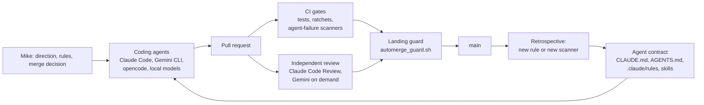

<div align="center">

# Cohezion

[](https://github.com/manderson240/cohezion/actions/workflows/ci.yml)
[](https://github.com/manderson240/cohezion/actions/workflows/codeql.yml)
[](https://github.com/manderson240/cohezion/actions/workflows/security-scan.yml)
[](https://www.python.org/downloads/)
[](LICENSE)

**A self-hosted platform where a fleet of coding agents builds, reviews and improves a large
Python codebase, and the CI gates I built to keep those agents honest.**

[How this was built](docs/HOW_THIS_WAS_BUILT.md) · [Agent guardrails](#guardrails-for-agent-written-code) · [Local inference](#local-inference-fleet-and-cost-aware-routing) · [Quick start](#quick-start)

</div>

---

## What this is

Cohezion is a one-person engineering organization in which the engineers are AI agents.
Almost all of the code was written by coding agents (Claude Code, Gemini CLI, opencode and
local models) working under an operating contract, specialist roles, and CI gates that I
designed. My job is the one an engineering lead has: set direction, write the rules, decide
what merges, and build the checks that catch agents when they are wrong.

The interesting part is not that agents wrote a lot of code. It is the machinery that makes
agent-written code trustworthy at this volume. That story, including what went wrong, is in
**[docs/HOW_THIS_WAS_BUILT.md](docs/HOW_THIS_WAS_BUILT.md)**.

### By the numbers

Measured from the repository on 2026-10-23.

| | |
|---|---|
| Commits on `main` | 2,302 (Nov 2025 to Oct 2026) |
| Pull requests merged | 201 (plus 95 closed without merging) |
| Test functions | about 13,500, in 1,213 test files |
| GitHub Actions workflows | 27, including CI, CodeQL, dependency review and multi-model PR review |
| Custom CI scanners for agent failure modes | 17 wired into the CI pipeline ([`scripts/ci/`](scripts/ci/)) |
| Pre-commit hooks | 19, including secret detection, bandit and a hardcoded-path guard |
| Specialist agent definitions | 21 ([`.claude/agents/`](.claude/agents/)) |
| Versioned skills agents load on demand | 229 PRIME skills ([`src/cohezion/skills/`](src/cohezion/skills/)) |

---

## How the work gets done



- **An operating contract every agent inherits.** [`CLAUDE.md`](CLAUDE.md) and
  [`AGENTS.md`](AGENTS.md) carry the standing rules: security, package management, MCP server
  conventions, how to report findings. [`.claude/rules/`](.claude/rules/) holds the hard-won ones,
  such as [`verification-depth.md`](.claude/rules/verification-depth.md).
- **Specialist roles.** 21 agent definitions (code reviewer, test runner, performance engineer,
  MCP specialist and so on) so work is routed to an agent with the right context and tools.
- **Independent review.** The agent that writes a change is never the one that signs off on it.
  Claude Code Review runs as a GitHub Action on every PR, and Gemini review and triage can be
  dispatched from a PR comment.
- **A landing guard.** [`scripts/ci/automerge_guard.sh`](scripts/ci/automerge_guard.sh) validates
  each PR merged on top of the current tip of `main` in a temporary worktree, serializes landings,
  and blocks only on failures the PR itself caused.
- **Every incident becomes a rule or a gate.** When an agent gets something wrong in a way tests
  missed, the fix is a new invariant in the contract or a new CI scanner, so the next agent cannot
  repeat it.

---

## Guardrails for agent-written code

Coding agents fail in characteristic ways: they write code that nothing calls, tests that cannot
fail, and try/except blocks that quietly swallow errors, and all of it can sit behind a wall of
green unit tests. These scanners, all in [`scripts/ci/`](scripts/ci/) and run by the
[CI pipeline](.github/workflows/ci.yml), target those failure modes directly. Most ship with a
`--self-test` that proves the gate can go red before it is trusted to say green.

| Scanner | The question it asks |
|---|---|
| [`dormancy_scan.py`](scripts/ci/dormancy_scan.py) | Does a production consumer actually call this capability, or only the tests? |
| [`falsifiability_scan.py`](scripts/ci/falsifiability_scan.py) | Can this invariant ever fail? |
| [`false_contract_scan.py`](scripts/ci/false_contract_scan.py) | Does the function do what its name promises? |
| [`phantom_attr_scan.py`](scripts/ci/phantom_attr_scan.py) | Is code reading an attribute the class never defines, hidden behind a `getattr` default? |
| [`declared_field_scan.py`](scripts/ci/declared_field_scan.py) | Does a persisted record actually write every field it declares? |
| [`unrestricted_exec_scan.py`](scripts/ci/unrestricted_exec_scan.py) | Is model-generated code ever run outside the sandbox? |
| [`check_inference_port_bypass.sh`](scripts/ci/check_inference_port_bypass.sh) | Is anything calling a model server directly instead of through the router? |
| [`doc_code_consistency.py`](scripts/ci/doc_code_consistency.py) | Do the docs still describe the code? |
| [`mutation_ratchet.py`](scripts/ci/mutation_ratchet.py), [`mypy_ratchet.py`](scripts/ci/mypy_ratchet.py), [`ruff_ratchet.py`](scripts/ci/ruff_ratchet.py) | Did this change make surviving mutants, type errors or lint debt worse than the committed baseline? |

The ratchets matter for a codebase this size. They let existing debt be paid down over time
while guaranteeing no agent can add to it.

---

## Local inference fleet and cost-aware routing

Most routine model calls never leave the machine. A single router endpoint (Lemonade, port
`:13305`) serves models across the NPU, iGPU and CPU of one AMD Strix Halo workstation, and
cloud models are the last resort.

```
Lemonade router :13305
├── NPU   small model      classification, routing, short answers
├── iGPU  mid-size model   code generation, structured output
├── CPU   8B reasoning     multi-step analysis
└── Cloud                  only when local quality gates fail
```

- **Tier prediction with honest statistics.** The router picks the cheapest tier whose Wilson
  lower confidence bound on past clean successes clears a threshold
  ([`compound/difficulty_estimator.py`](src/cohezion/compound/difficulty_estimator.py)). That
  replaced a frequency cutoff that was fooled by lucky cheap successes.
- **Health may only escalate.** Hardware health signals can push a hard task to a stronger tier,
  never to a cheaper one.
- **One chokepoint.** CI fails any code that calls a model server directly instead of going
  through the router.
- **Memory-aware admission.** An admission gate prices each model load against KV-cache
  reservation and memory headroom, so the fleet does not run itself out of memory.

```python
from cohezion.inference.triune_orchestrator import build_triune_orchestrator
from cohezion.compound import make_executor

executor = make_executor(mcp_client, provider=build_triune_orchestrator())
result = await executor.execute_task("Your task here")
```

A reproducible cost and latency benchmark across Claude-only, local-only and hybrid
configurations is in progress (`uv run python scripts/benchmark_fleet.py`). Until it has run on the full prompt
corpus, this README makes no cost-savings claim.

---

## Self-improving skills

Agents load versioned skill files on demand instead of carrying everything in context. After
an execution, a retrospection step extracts what was learned and a refiner can version-bump the
skill, gated by a regression check that fails closed when it cannot evaluate.

```
Execute (CompoundExecutor) → Reflect (RetrospectionEngine) → Refine (SkillRefiner) → next run uses the better skill
```

Run one cycle: `uv run python scripts/drivers/compound_cycle.py`

---

## Quick start

```bash
git clone https://github.com/manderson240/cohezion.git && cd cohezion
uv sync

# Offline tour: step an agent through the RL environment (no network, no GPU)
uv run python examples/quickstart.py

# Validate the compound loop invariants
make validate

# Run the test suite
make test
```

**Requires** Python 3.13+ and [uv](https://github.com/astral-sh/uv). Installs from source only.
GPU extras pin AMD ROCm wheels; see [`docs/tutorials/`](docs/tutorials/) for a guided setup.

---

## Where to look first

| If you want to see | Look at |
|---|---|
| How agents are directed | [`CLAUDE.md`](CLAUDE.md), [`AGENTS.md`](AGENTS.md), [`.claude/agents/`](.claude/agents/), [`.claude/rules/`](.claude/rules/) |
| The guardrails | [`scripts/ci/`](scripts/ci/), [`.github/workflows/ci.yml`](.github/workflows/ci.yml), [`.pre-commit-config.yaml`](.pre-commit-config.yaml) |
| The landing process | [`scripts/ci/automerge_guard.sh`](scripts/ci/automerge_guard.sh) |
| Inference routing | [`src/cohezion/inference/`](src/cohezion/inference/), [`src/cohezion/compound/difficulty_estimator.py`](src/cohezion/compound/difficulty_estimator.py) |
| The compound loop | [`src/cohezion/compound/`](src/cohezion/compound/) |
| The full story | [`docs/HOW_THIS_WAS_BUILT.md`](docs/HOW_THIS_WAS_BUILT.md) |

---

## Research directions

Cohezion also hosts exploratory research that is deliberately separate from the engineering
platform above. The main thread is a [Gymnasium](https://gymnasium.farama.org/)-compatible RL
environment (`ManifoldEnv`) that tests whether safe behavior can be shaped into an
environment's dynamics, through an attractor term, instead of being added as a reward penalty.
It lives in [`src/cohezion/environments/`](src/cohezion/environments/) and
[`src/cohezion/physics/`](src/cohezion/physics/), with write-ups in
[`research/manuscripts/`](research/manuscripts/).

| Algorithm | Reward mode | Steps | Episode reward |
|---|---|---|---|
| PPO | curriculum | 100K | 14.23 |
| SAC | dense | 100K | 40.77 |
| PPO | dense | 100K | 38.95 |

Reproduce with `uv sync --extra rl && make benchmark`. This is early-stage, self-defined work
and should be read as exploration, not as a validated result.

---

## Development

```bash
make format      # ruff format
make lint        # ruff check + auto-fix
make test        # full test suite
make validate    # compound loop invariant checks
```

```bash
uv run uvicorn cohezion.api:app --reload    # FastAPI backend on :8080
cd src/web/anima_dashboard && npm run dev   # dashboard on :3000
```

Contributions are welcome. See [CONTRIBUTING.md](CONTRIBUTING.md).

## License

Dual-licensed: [AGPL-3.0-or-later](LICENSE) for open-source use, with a commercial license
available for closed-source deployments. See [LICENSING.md](LICENSING.md).
