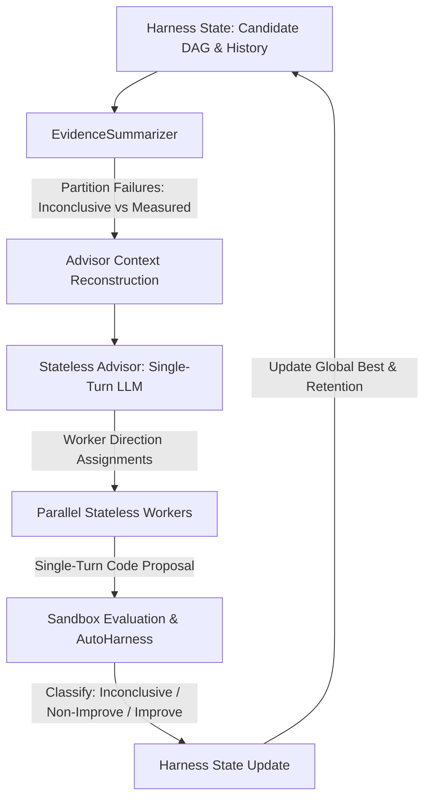

# Stateless Language Agents (SLA): Scaling Long-Horizon Automated Research
**arXiv Reference**: [arXiv:2610.07625](https://arxiv.org/abs/2610.07625) (October 2026)  
**Authors**: Nicholas Crispino, Guanzhi Wang, Montgomery Bohde, Peter Stone, Yuandong Tian (FAIR at Meta, UT Austin, Georgia Tech)  
**Cohezion Research & Abstraction Report**  
**Date**: October 13, 2026  
**Status**: Formal Abstraction & Algorithmic Synthesis  

---

## 1. Executive Summary & Core Paradigm Shift

In long-horizon automated scientific research and algorithmic optimization, autonomous agents must explore expansive hypothesis spaces across tens or hundreds of iterative experimentation cycles. Prevailing multi-agent paradigms—such as **CORAL**, **SwarmResearch**, **EvoX**, and conversational agent graphs—model agents as persistent, stateful conversational entities that continuously accumulate message history.

The authors of **arXiv:2610.07625** identify a catastrophic scaling bottleneck in stateful multi-agent systems:
1. **Context Bloat & Token Degradation**: By iteration 30, persistent agent dialogues accumulate $\approx 99\text{K}$ tokens per call, with over **99.4%** of tokens spent repetitively processing conversational history rather than synthesizing novel code.
2. **Context Rot & History Fatigue**: Long histories lead to attention degradation, where LLMs over-index on historical conversational quirks and fail to spot novel search branches.
3. **Cross-Worker Duplication**: Without centralized, stateful discipline, parallel workers explore overlapping paths and replicate failed trials.

### The Fundamental Axiom of SLA:
> **"Stateful Search with Stateless Agents"**  
> All system state (candidate programs, evaluation scores, execution logs, failure modes, lineage graphs) is maintained strictly by the **deterministic harness**.  
> Agents—both the **Advisor** and the **Workers**—are **stateless, single-turn mathematical functions** $f(\mathcal{C}_{\text{reconstructed}})$. No conversational history is preserved across epochs.

---

## 2. Mathematical Formalization

Let $\mathcal{S}_t$ denote the state of the research harness at epoch $t$:
$$\mathcal{S}_t = \left( \mathcal{D}, \mathcal{T}_{\text{eval}}, \mathcal{G}_{\text{lineage}}, \theta^* \right)$$
where:
- $\mathcal{D} = \{ (c_i, s_i, o_i, \tau_i) \}_{i=1}^N$ is the set of all evaluated candidate solutions $c_i$, their objective metric scores $s_i \in \mathbb{R}$, their execution outcome $o_i \in \Omega$, and diagnostics $\tau_i$.
- $\Omega = \{ \text{MEASURED\_IMPROVEMENT}, \text{MEASURED\_NON\_IMPROVEMENT}, \text{INCONCLUSIVE\_FAILURE} \}$ is the partitioned outcome space.
- $\mathcal{G}_{\text{lineage}}$ is the directed acyclic graph (DAG) of candidate ancestry.
- $\theta^* = \arg\max_{c \in \mathcal{D}} s(c)$ is the current global best candidate.

### 2.1 The Two-Level Coordination Loop

1. **Epoch Beginning ($t$)**:
   The harness synthesizes the **Advisor Context** $\mathcal{C}_{\text{adv}}(\mathcal{S}_t)$:
   $$\mathcal{C}_{\text{adv}}(\mathcal{S}_t) = \text{EvidenceSummary}(\mathcal{D}) \cup \{ \theta^* \} \cup \text{DirectionTree}(\mathcal{G}_{\text{lineage}})$$
   
   The **Stateless Advisor** is invoked as a single-turn functional query:
   $$\mathbf{A}_t = f_{\text{Advisor}}(\mathcal{C}_{\text{adv}}(\mathcal{S}_t))$$
   where $\mathbf{A}_t = \{ a_1, a_2, \dots, a_M \}$ assigns an explicit research hypothesis/direction $a_m$ to each parallel worker $m \in \{1, \dots, M\}$.

2. **Worker Local Search ($k$-trial iterations)**:
   For each worker $m$, the harness constructs the localized **Worker Context** $\mathcal{C}_{\text{wrk}}(a_m, c_m^{(j)}, \tau_m^{(j)})$:
   $$\mathcal{C}_{\text{wrk}} = \{ \text{Hypothesis } a_m \} \cup \{ \text{Active Candidate } c_m^{(j)} \} \cup \{ \text{Local Error Diagnostics } \tau_m^{(j)} \}$$
   Crucially, $\mathcal{C}_{\text{wrk}}$ contains **zero** global history, zero peer worker transcripts, and zero cumulative conversation tokens.

   The **Stateless Worker** proposes refinement $\Delta c$:
   $$c_m^{(j+1)} = f_{\text{Worker}}(\mathcal{C}_{\text{wrk}}(a_m, c_m^{(j)}, \tau_m^{(j)}))$$

---

## 3. Key Architectural Invariants

### 3.1 Failure Disambiguation in Evidence Summaries
A critical finding in the paper is that failing to distinguish between **implementation failures** and **empirical failures** cripples automated research:

1. **`INCONCLUSIVE_FAILURE`**:
   - Symptoms: `SyntaxError`, `ImportError`, CUDA `OutOfMemoryError`, segmentation fault, evaluator timeout, or unhandled exception.
   - Semantic Meaning: The implementation was defective or unexecutable; the underlying scientific hypothesis remains **untested**.
   - Harness Action: Log the syntax/runtime diagnostic $\tau_i$, do NOT penalize or prune the research direction in the Advisor summary, and provide specific error feedback to the worker.

2. **`MEASURED_NON_IMPROVEMENT`**:
   - Symptoms: Code executed successfully, produced valid test outputs, evaluated against the loss/metric function, but scored $s_i \le s_{\text{baseline}}$.
   - Semantic Meaning: Valid empirical counter-evidence. The hypothesis was tested and found unhelpful under current conditions.
   - Harness Action: Record negative result in the evidence summary; Advisor dampens allocation to this direction.

3. **`MEASURED_IMPROVEMENT`**:
   - Symptoms: Executed cleanly, passed AutoHarness verifications, strictly increased score $s_i > s^*$.
   - Semantic Meaning: Valid empirical breakthrough.
   - Harness Action: Update $\theta^* \leftarrow c_i$, expand the lineage branch.

### 3.2 Local Candidate Retention with Global Reset
In naive greedy search, any trial that scores below $\theta^*$ is instantly discarded. However, complex algorithmic improvements often require multiple complementary modifications before yielding positive returns:

- **Local Retention ($k$-trial budget)**: When a worker pursues a direction $a_m$, the harness allows the worker to retain and refine candidate $c_m$ over $k$ local iterations (e.g. $k=3$), even if $s(c_m) < s(\theta^*)$.
- **Global Reset**: If the Advisor reassigns the worker to a different direction, or if $k$ local trials fail to surpass the baseline, the worker's working candidate is reset to the global best $\theta^*$.

### 3.3 Extreme Token Efficiency
- The Stateless Advisor consumes **$<0.6\%$** of the total token budget while directing high-level exploration across parallel workers.
- The overall SLA framework achieves **$>84\%$ reduction in token consumption** compared to persistent conversation agents (CORAL, SwarmResearch), completely eliminating token context creep and memory degradation.

---

## 4. Mapping to Cohezion Architecture & Kaggle Competitions

| SLA Component | Paper Specification | Cohezion Implementation |
|---|---|---|
| **Harness State** | File system + Python state tree | `SLAHarness` + SurrealDB `learning`/`kanban_item` |
| **Stateless Advisor** | LLM single-turn summary call | `StatelessAdvisor` via `deepseek-v4-pro:cloud` or `glm-5.3:cloud` |
| **Stateless Worker** | LLM single-turn code proposal | `StatelessWorker` via `kimi-k2.7-code:cloud` or `glm-5.3:cloud` |
| **Verification Gate** | Python subprocess run + score | `AutoHarness` bytecode verifier + Rust `cohezion_physics_core` |
| **Failure Disambiguation** | Parser classifying run logs | `EvidenceSummarizer.classify_outcome()` |
| **Target Workload** | DiscoveryBench / MLE-bench | ARC-AGI-2 DSL synthesis, ARC-3 affordance search, CASMI26 feature ensembling |

---

## 5. Algorithmic Workflow

---

## 6. Mathematical Invariants for Implementation
1. **Stateless Invariant ($\mathcal{I}_{\text{stateless}}$)**:
   $$\forall \text{ call } j, \quad \text{context\_history}(j) = \emptyset$$
   Neither Advisor nor Worker preserves conversational state across calls.
2. **Outcome Partition Invariant ($\mathcal{I}_{\text{partition}}$)**:
   $$\Omega_{\text{inconclusive}} \cap \Omega_{\text{measured\_non\_imp}} \cap \Omega_{\text{improvement}} = \emptyset$$
3. **Monotonic Best Invariant ($\mathcal{I}_{\text{monotonic}}$)**:
   $$s(\theta^*_{t+1}) \ge s(\theta^*_t)$$
