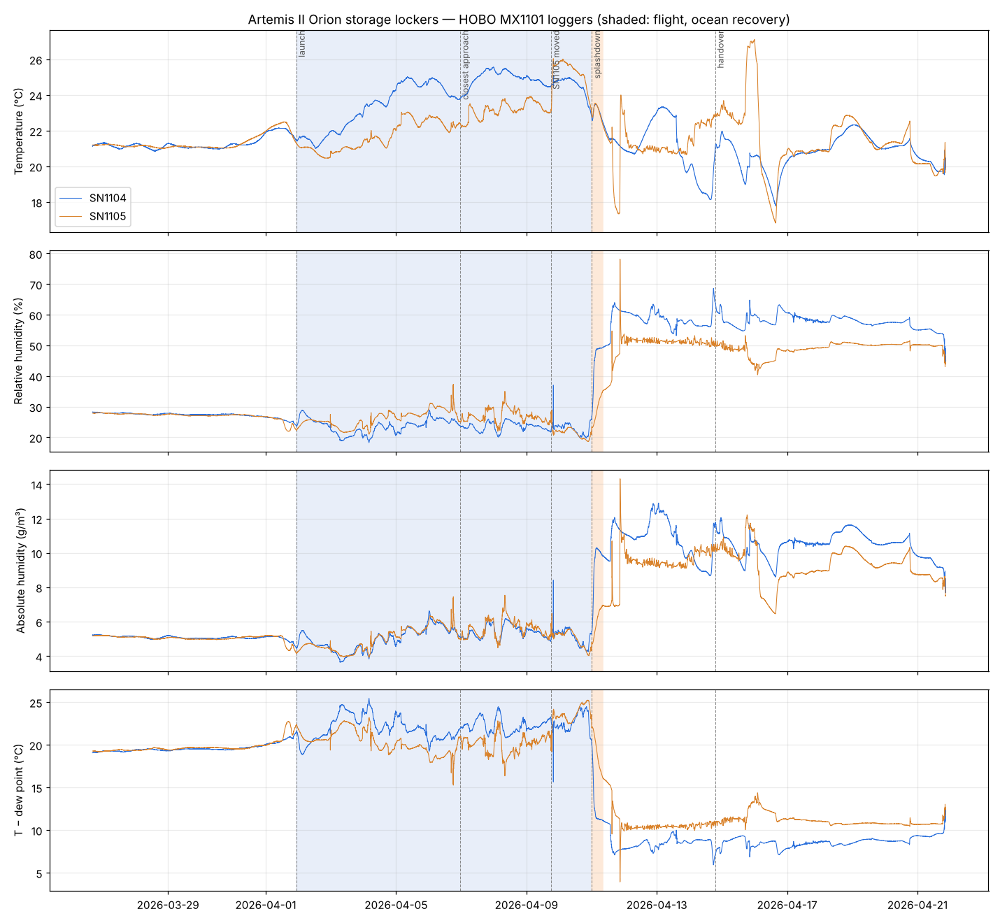
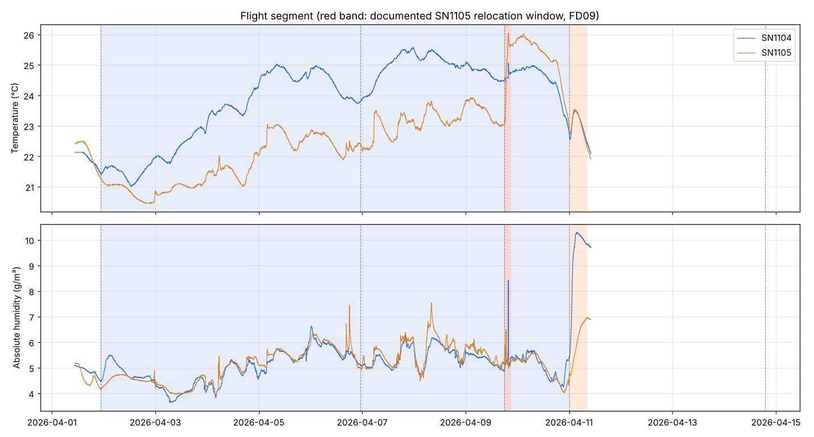

# Artemis II science archive — first look (PDS release 2026-10-07)

Source: PDS Geosciences Node, <https://pds-geosciences.wustl.edu/missions/artemis2/index.htm>.
The first delivery has four bundles: crew cameras, Orion cameras, mission audio (all at the
PDS Cartography and Imaging Sciences Node), and the Mission Bundle (documents plus Orion
locker temperature/humidity) at the Geosciences Node. The SPICE geometry bundle is still
**delayed**, so nothing here depends on pointing or footprints.

Reproduce the locker analysis (it downloads its own inputs into the git-ignored `data/` directory):

```bash
uv run --no-project --with polars --with matplotlib python research/artemis2/analyze_hobo.py
```

The flash and transcript analyses (section 3):

```bash
uv run --no-project --with numpy --with scipy --with pillow python research/artemis2/flash_map.py   # downloads the annotation PDF
uv run --no-project --with polars python research/artemis2/transcripts.py DIR    # DIR = downloaded data_transcripts_* folders
uv run --no-project --with numpy --with scipy --with pillow python research/artemis2/flash_search_stills.py PNG...  # crew browse PNGs
uv run --no-project --with numpy --with scipy python research/artemis2/flash_search_video.py CH1.mp4 CH2.mp4      # SAW3 videos, 2.9 GB each; ~50 min
```

Outputs: `hobo_results.json` and `figures/`. Every number quoted in this section is written
to `hobo_results.json` by the script, under the key named in brackets. The script checks
both downloads against the MD5s in the PDS bundle manifest, and reads the label statistics
from the PDS4 XML labels.

## How this work is validated

| Layer | What it checks | How to run it |
|---|---|---|
| Input integrity | Both CSVs and XML labels match the MD5s in the PDS bundle manifest; a tampered file is rejected | built into `analyze_hobo.py` |
| Label cross-check | Data min/max/mean/std reproduce the statistics in the PDS4 labels, parsed from the XML | `label_vs_data` in `hobo_results.json` |
| Traceability | Every number quoted in section 1 is written to `hobo_results.json`, under the key named in brackets | re-run the script |
| Reproducibility | A clean run from fresh downloads reproduces the committed JSON and figures byte for byte | the reproduce command above |
| Differential oracle | The polars port reproduces the previous pandas implementation on every field and all three figures; the only differences are two values in `phases` that pandas rounded with half-to-even scaling (23.895 -> 23.9) and Python rounds exactly (-> 23.89) | compare against the JSON at commit `2a59d6b` |
| Unit tests (CI-gating) | 12 offline tests of the transient detector, phase boundaries, derived humidity, CDT->UTC conversion, label parser and checksum gate. Mutation-tested: breaking each mechanism turns at least one test red | `uv run --no-project --with polars --with pytest python -m pytest tests/unit/research/test_artemis2_hobo.py --noconftest` |
| Adversarial review | Three independent reviewers (scientific rigor, primary-source re-check against the live PDS archive, code/reproducibility/security), each told to assume the work was wrong | corrections in commits `6c9d523`, `4a84aa5`, `d9a12c7` |
| Flash map | The grid fit recovers known meridians from synthetic grids (and a different grid is not mis-read as 90°E/180°E). Projection and inverse projection round-trip. With the view fixed from Horizons, the drawn meridians fit at 85°E/186°E, an independent check that the render matches Orion's real geometry. Mutation-tested | `tests/unit/research/test_artemis2_flash_map.py` |
| Quotes | Every curated transcript quote must match a CSV row verbatim at its UTC stamp, or `transcripts.py` exits non-zero (39 of 39 match) | `transcripts.py` |
| Flash searches | Synthetic tests: a 3-frame point flash is found at its frame and place; steady stars, long brightenings and whole-frame changes are not; triage separates a rise from dark from flicker of an existing source | `tests/unit/research/test_artemis2_flash_search.py` |
| Primary-source spot checks | Transcript quotes, duplicate images, the missing video segment and the HTTP 403 audio entry were checked against the source files by hand | — |

What this does **not** cover: the crew-camera, Orion-camera and audio numbers in section 3 come from the PDS
inventories and the Atlas search index, checked by a reviewer, but there is no committed script that regenerates them.

## 1. Orion locker environment (2 × HOBO MX1101, 60 s cadence)

Two loggers sat in bags in the crew-cabin storage lockers that future missions will use for
returned lunar samples. SN 1104 was in **Locker E** (bag L_011) for the whole mission. SN 1105
started in **Locker D** (bag L_022) and was moved to **Locker F** (bag R_027) on FD09. The logs
run from 2026-03-26 to 2026-04-21: six days on the pad, the 9.1-day flight, and ten days of
recovery and shipping. With two loggers on one flight, every comparison below mixes the
locker, the bag and the position inside it. These data cannot separate those effects.



### Data quality: clean
- **Complete:** 37,706 and 37,690 records with no gaps. Every interval is exactly 60 s and the
  sequence numbers are continuous.
- **Labels are accurate:** the PDS4 label statistics (min, max, mean, std) match the data to
  rounding [`label_vs_data`].
- **Dew point checks out:** the logged dew point matches a Magnus–Tetens recomputation to
  ≤0.04 °C with the coefficients used here; the residual depends on the coefficient set
  [`dewpoint_resid_C`].
- **Cross-calibration is good:** on the pad the two loggers have a mean offset of 0.05 °C and
  0.27 % RH, with single-minute differences up to 0.39 °C and 3.2 % RH
  [`diff_1105_minus_1104_by_phase`, `pad_single_minute_max_abs_diff`].
- **The timezone is CDT (UTC−5), as labelled.** The PDS label start (16:25:46Z) equals the
  first CSV row (11:25:46 CDT) + 5 h. DST ran 2026-03-08 to 11-01, so the offset is constant
  across the record.

### What the data tells us
1. **The lockers stayed as dry in flight as on the pad.** Mean absolute humidity was 5.1 g/m³
   in flight and 5.1 g/m³ on the pad, with RH between 18 and 37 % [`abs_humidity_by_phase_gm3`].
   During flight the air never came within 15.3 °C of its dew point, so condensation in the
   lockers was not a concern [`flight_min_dewpoint_margin_C`].
2. **The lockers warmed slowly, then cooled before reentry.**
   - The linear trend was +0.37 °C/day in Locker E and +0.49 °C/day in Locker D→F
     [`flight_T_trend_C_per_day`].
   - Locker E's 12-hour mean peaked at 25.4 °C on 04-07/08 [`flight_T_12h_mean_max`] and was
     22.8 °C in the 30 minutes before splashdown.
   - A detrended power spectrum shows no clear periodicity, such as a 24-hour crew-schedule
     line (`figures/hobo_flight_spectrum.png`).
3. **There is no detectable thermal trace of the flyby or the eclipse.** Between 22:00 and
   02:00, covering closest approach (23:00) and the roughly 56-minute solar eclipse (section 2),
   the loggers' temperatures stayed in these ranges [`flyby_window_22_02`]:
   - Locker E: 23.74–23.98 °C, a 0.24 °C range, the same as the median 4-hour range in flight
     [`flight_4h_T_range_median_C`].
   - Locker D: 22.18–22.44 °C.

   This is a weak test. The loggers are bagged and respond over hours, the eclipse lasted
   under an hour, and the cabin is actively controlled. A small effect would not show.
4. **After splashdown, humidity rose in both lockers, at very different times and rates**
   [`splashdown_humidity`]:
   - **Locker E:** absolute humidity crossed 5σ above its pre-splashdown level at 00:24 UTC,
     17 minutes after splashdown. It reached 9.5 g/m³ two hours after splashdown and 10 g/m³
     at 02:48, and stayed high.
   - **Locker F:** it did not cross 5σ until 01:42. It was still 7.0 g/m³ eight hours later
     and first reached 7 g/m³ at 14:08, just before a sharp excursion near 15:00.
   - **The point for sample-curation planning:** in at least one locker, terrestrial humidity
     reached the samples within about half an hour of splashdown, more than 3.5 days before
     the bags were handed over. These data cannot show why the two lockers differed
     (locker, bag, position, or ventilation path).
5. **Most of the extreme values in the archive are post-mission.**
   - These come from recovery and shipping: SN 1105's label maxima (27.1 °C, 78 % RH), both
     loggers' RH and dew-point maxima, and the smallest dew-point margin (3.9 °C).
   - The exception is SN 1104's temperature maximum of 25.57 °C, reached in flight at 04-07
     23:43 UTC [`T_max_at`, `RH_max_at`, `min_margin_at`].
   - Anyone who uses the label statistics as "the flight environment" will overstate it.

### Anomalies and curiosities
- **Filename error.** Both files are named `art002_086-…`.
  - The guide's filename spec for the HOBO loggers is `art002_<UTC Start Date in
    DOY-hhmmss>_<UTC End Date in DOY-hhmmss>_…` (Appendix, "HOBO data loggers").
  - The actual start, 2026-03-26, is **DOY 085** in both UTC and CDT.
  - The end field, `111`, is correct, so this is an off-by-one in the start field
    [`filename_start_doy`, `actual_start_doy`].
- **The FD09 relocation leaves a clear signature, but the guide gives only a window.** The
  documented move window is 18:00–21:00 UTC. RH transients inside that window
  [`fd09_relocation`]:
  - **SN 1105:** two, at 18:09 (+1.2 %) and 18:45 (+4.5 %).
  - **Locker E (SN 1104):** one large transient at 19:49:
    - RH jumped +12.3 % in one minute and was back within 1 % of its prior level two minutes
      later.
    - Temperature rose from 24.58 to 25.06 °C and was still 24.80 °C after 15 minutes.
    - Absolute humidity went 5.48 → 8.41 → 5.16 g/m³, ending *below* its prior level.
  - **What these show:** the coupled, lasting response rules out a single-sample glitch. The
    logs fit handling of the bags during the documented FD09 stowage. At 19:50 SN 1105 also
    shows a small +0.8 % RH rise, so the two bags may have been handled together.
  - **When the move happened:** the data cannot say which of 18:45 or 19:49 was the move
    itself.
  - **Lockers D and F differ in temperature:** over 6 hours either side of the window,
    SN 1105's mean temperature rose 23.07 → 25.76 °C while Locker E rose 24.50 → 24.78 °C.
    Locker F therefore ran about **2.4 °C warmer than Locker D**, assuming D followed E's
    trend.
- **Sharp RH transients are consistent with bag or locker handling, but no record says what
  caused them.** Counts depend on the threshold [`transient_counts`]:

  | Logger period | ≥1 % | ≥1.5 % | ≥3 % |
  |---|---|---|---|
  | Locker D, launch → FD09 move window | 8 | 4 | 1 |
  | Locker F, after the move | 0 | 0 | 0 |
  | Locker E, whole flight | 2 | 1 | 1 |

  The largest Locker D transient, 04-06 18:09 (+4.6 %), falls inside "Pre-Flyby Crew Conference
  and Camera Setup" (17:03–18:17) in Table 4. That is a coincidence in time, not evidence of
  what was stored where.
- **An RH step shortly before splashdown.** About 7 minutes before splashdown, both loggers
  show an RH step of at least 5 times their own preceding noise [`reentry_rh_step`]:
  - SN 1105: +2.0 % at 00:00, against noise of 0.13 %.
  - SN 1104: +0.4 % at 23:59:46, against noise of 0.03 %.

  The archive gives no parachute or vent timeline, so the cause is unknown.



## 2. Lunar Targeting Package / Outgoing Target Request (`artemis2_outgoing_target_request.json`)

This file lists 39 entries: 30 numbered observation targets and 9 lettered crew-swap or
break entries. The crew request times run from **18:45 to 01:23 UTC**. The geographic targets were
Glushko, Ohm (each scheduled twice), the Aristarchus Plateau, Reiner Gamma, Orientale Basin
(twice), Vavilov and Hertzsprung. Non-geographic targets included Earthset and Earthrise
around loss of signal, **Impact Flashes**, **Lofted Lunar Dust**, and the eclipse sequence
(Sunset, Eclipsed Moon / Deep Space, Sunrise). The file's geometric event times are Earthset
22:42–22:46, Earthrise 23:25, Sunset 00:35 and Sunrise 01:31–01:33, so loss of signal lasted
about 40 minutes and the solar eclipse about 56 minutes. The "request" times are crew
prompts and differ from these by up to 8 minutes; the Sunrise request (01:23) came 8 minutes
before the event.

Defects in the file:
- **Hertzsprung Basin has latitude, longitude and diameter all 0.** It is a real ~570 km
  farside basin, and it has no science-objective (STM) flags. The other geographic targets
  have coordinates, and spot checks against IAU positions agree for Glushko, Ohm,
  Aristarchus and Reiner Gamma. Reiner Gamma's diameter is 0, which may be deliberate for an
  albedo swirl. Hertzsprung looks like an incomplete late addition.
- **Inconsistent time formats.** The time fields use three formats (`06 Apr 2026
  18:00:00.000000`, `6 Apr 2026 18:00:00.000`, and blank for 6 entries), so a naive parser
  will fail. The guide's Table 4 also has a typo: `2026:04:05`.

## 3. Crew camera, Orion camera and mission audio bundles

The PDS Imaging Node has no public directory listing. The files are served from
`https://d1ejlg980osaur.cloudfront.net/archive/artemis/artemis2/<bundle>/`. The full label
contents can be searched through the Atlas Elasticsearch endpoint
(`POST https://pds-imaging.jpl.nasa.gov/api/search/atlas/_search`). Counts below come from
the collection inventories and that index; the key numbers are in `imaging_summary.json`.

| Bundle | Contents |
|---|---|
| Crew camera (~2.5 TB) | 10,329 exposures × 4 forms (NEF source, raw TIFF, processed TIFF, browse PNG). Nikon D5 s/n …015: 7,007; D5 …017: 552; Z9 …019: 2,770. 80–400 mm lens on 75 % |
| Orion camera | 1,012 images (OpNav 404, DCAM 249, SAW3 189, CAB2 148, SAW4 12, SAW2 10) + 22 SAW3 videos |
| Mission audio | 53 crew tablet (PCD) recordings (8.7 h), two 24-h Orion-to-Earth voice-loop days + one clip (~57 h total), 56 transcripts (6,355 lines), 5 annotation PDFs |

**The flyby dominates the crew camera bundle.** Of the 10,329 crew images, 6,484 were taken
on 04-06 UTC and 2,299 on 04-07. The busiest hours were 04-06 21:00 (1,838 images) and 04-07
00:00 (1,715). In comparison, 04-08 has 8 images and 04-09 has 71.

### What the crew reported: lunar impact flashes
From the voice-loop transcript `art002_2026-04-07_oe1_trn-csv_v01.csv`. Times are from its
`utc` column. The `audio_time` column is a position in a stitched-together recording. The
`utc` segment containing these rows has zero offset and matches the eclipse geometry: "The
sun has gone behind the moon" at 00:38, against a computed sunset of 00:35.

> **00:59:10, Wiseman:** "We have seen three impact flashes so far… Jeremy saw two, so that's
> four total… It was not sun glint off a particulate from the thrusters or the purge tanks. It
> was definitely impact flashes on the moon. And Jeremy just saw another one."
>
> **01:00:04, Wiseman:** "they've all been either on or a bit south of the equator and **on
> the Earth side of the moon**."
>
> **01:00:32, science team:** "we have citizen scientists here on Earth looking for impact
> flashes. So hearing you saw them **on the near side** means that people saw them too."

**The crew's own map: where the flashes were.** The annotation PDF
`art002e016252_pcd_ann_v01.pdf` is a OneNote planning render of the Moon for 7 Apr 2026
01:04 UTC. The crew drew dots on it, one colour each: Hansen red, Wiseman blue, "Ike"
(Glover) green. They numbered five flashes and wrote: "these three roughly 10 min into
eclipse" (#1–#3), "#4 (later)", "#5 towards end", and circled #2 and #4 as "likely same
impacts". `flash_map.py` turns the dots into lunar coordinates. It fits a sphere projection
to the render's lit limb, drawn equator and two drawn meridians, with the viewing geometry
fixed from JPL Horizons (Moon seen from Artemis II, `500@-1024`). Output is in
`flash_annotations.json`.

| # | marked by | when (crew note) | longitude | latitude |
|---|---|---|---|---|
| 1 | Wiseman | ~10 min into eclipse | 143–145°E | 22–23°S |
| 2 | Hansen, Wiseman (circled) | ~10 min into eclipse | 100–104°E | 16–17°S |
| 3 | Hansen | ~10 min into eclipse | 168–169°E | 15°S |
| 4 | Hansen, Wiseman, Glover (circled) | later | 121–123°E | 49–53°S |
| 5 | Wiseman | towards end | 142–145°E | 52–57°N |

Ranges span two fits: the view fixed from Horizons (123.3°E), and the drawn grid forced to
exactly 90°E/180°E (129.5°E). The grid check is independent: with the Horizons view fixed,
the drawn meridians come out at 85°E and 186°E, i.e. a 90°/180° grid to within ~5°. The
render's Earthshine-lit crescent ends at the 90°E line, as it should. The real uncertainty
is larger than these ranges, because the dots were placed by hand from memory on a dark
image. The dots for #4 are 9° apart across three observers.

**Count.** The map shows five numbered flashes. Two of them (#2 and #4) were seen by more
than one person, and the circles match Hansen's next-day remark "Reid and I saw two
identical ones". The live tally at 00:59 was "three so far" plus "another one". Hansen also
said he "did not record at all where we saw" them. So the map was drawn from memory, not
logged live.

**Finding: the flashes were on the lunar far side, not the near side.** Every marked flash is
at 100–170°E. From Earth that night the Moon's disk was centred on 359.2°E (Horizons,
geocentre), so Earth could see only up to about 89°E. None of the five could have been
recorded by ground-based impact monitoring, which contradicts the 01:00 relay ("hearing you
saw them on the near side means that people saw them too"). Wiseman's "on the Earth side of
the moon" is best read as the side of the disk *as seen from Orion* that faced Earth (the
Earthshine side, west of 90°E). #2 lies just beyond it. Wiseman's next-day remark that none of
his were "in the Earth Glow side" agrees with the map. **Consequence:** Earth-based monitoring
cannot confirm these flashes. Confirmation would have to come from Orion's own cameras
(below) or from a later orbital search for fresh craters (e.g. LRO before/after imaging) at
these coordinates.

**When: the crew's call-outs, to the second.** The crew-tablet recording (PCD3
`art002a000052`) and the voice loop agree to about 1 s, for example 00:59:10.8 vs 00:59:11.0.
Quotes are verified verbatim by `transcripts.py`.

| UTC (04-07) | who | words |
|---|---|---|
| 00:41:00 | Wiseman | "I just saw a meteor -- I just saw a flash!" (at 00:42:33, asked flash or streak: "No, streaks.") |
| 00:51:15 | Wiseman | "100 percent just saw a meteorite" |
| 00:51:38–57 | Hansen | "it's just like a bloop" … "We saw an impact flash." |
| 00:52:52 | Hansen | "I think I just saw another one, but this one I'm less sure of" |
| 00:59:10 | Wiseman | "We have seen three impact flashes so far." |
| 00:59:18 | Hansen | "I just saw another one." |
| 01:03:04 | Wiseman | "I just saw another one." |
| 01:17:49 | Wiseman | "I think I just saw one." Glover relays (01:17:59): "right near the South Pole on the Terminator"; Wiseman (01:18:25): "I saw one in the upper right quadrant." |

These fit the annotation: the first three around 00:41–00:53 ("roughly 10 min into
eclipse"), #4 "later" around 00:59–01:03, and #5 "towards end" at ~01:18, near the north
limb and right of centre, matching "upper right quadrant". Glover's "South Pole" relay at the
same moment does not match #5. It may be a second flash, or a view rotated relative to the
render. It is unresolved.

**Caveats the crew raised themselves:**
- Wiseman's first call (00:41) turned into "streaks" (a meteor-like trail, not a point flash).
- At 00:51 Glover relayed that Wiseman had "seen two meteors".
- Wiseman later added "maybe it was a priming bias".
- Astronauts routinely see flashes from cosmic rays hitting the retina. Wiseman said there was a
  "100% difference in those and what we saw yesterday", but only from recollection.

**Did any camera catch one?** Two independent searches.
- *Crew stills* (`flash_search_stills.py` → `flash_search_stills.json`). I checked all 73
  frames taken within a few seconds before each call-out. Each flash happened while no long
  exposure was open:
  - At 00:41 the D5 was shooting bracketed bursts of 0.6–40 ms (about 3% of the time open).
  - Both 00:51 sightings fall in a one-minute gap in the Z9's eclipse series (00:50:51 to
    00:51:51).
  - Nothing was shooting just before 00:52:52, 00:59:18 or 01:03:04.
  - At 01:17–01:18 the D5 used 2.5–10 ms exposures.

  On the seven long Z9 exposures (2–4 s, 00:50–00:52) that show the whole dark disk, the
  search finds tens of sharp single-frame events per frame that are unique both on the
  sensor and on the disk. The brightest are short tracks with demosaic colour fringes, the
  signature of cosmic-ray hits on the sensor. In processed browse PNGs nothing can be
  separated from that background, so the stills give no detection.
- *SAW3 video* (`flash_search_video.py` → `flash_search_video.json`). The solar-array
  camera recorded the whole eclipse at 59.94 frames/s, on two downlink channels that are
  separate encodings of the same view (aligned to the frame; 97 of 300 test frames
  bit-identical). The search:
  - scanned 208,591 frames per channel, 00:35–01:33;
  - flagged any point brighter than the same pixel 6–12 frames before and after (a transient
    of 100 ms or less, ≥20 DN);
  - kept only events that appear in both channels within 3 frames.

  43 events pass the cross-channel check.
  - **40 are flickers of sources already there**: a drifting point source (probably a star
    or planet) and the corona-lit limb of the Moon. Their reference level is 26–234 DN.
  - **3 rise from dark** (00:35:54, 00:37:24, 00:40:58). All three sit at the tip of the
    corona-lit limb, on one five-minute track drifting with the camera attitude.

  The 00:40:58 event comes 2.5 s before Wiseman's "I just saw a flash!", but it is edge
  flicker on that track, not a point on the dark disk. Wiseman himself revised that sighting
  to "streaks". **No impact flash is detected in the video.** That is not evidence against
  the crew: SAW3 pointing is not yet archived, so whether the mapped sites were in its field
  is unknown. Its sensitivity to a 1–10 ms flash is also unknown. And because the two
  channels share one sensor, matching across them rules out encoding glitches but not sensor
  events.

**Why the geometry helped:** the eclipse removed the Sun's glare and let the crew dark-adapt
while looking at the night hemisphere. Orion was also ~11,800 km from the Moon (Horizons, at
01:04), not 384,000. So a given flash was about 7 magnitudes brighter than it would be from
Earth, (384,000/11,800)² ≈ 1,000×. Together these favour seeing faint, brief flashes.

Other notable observations:
- **Glow around the eclipsed Moon.** At 01:02:05 Hansen describes "the glow around the moon… once
  your eyes adjust" as "easily 10 widths or diameters of the sun around the entire moon". This
  is a dark-adapted, naked-eye estimate. It may be the corona or scattered light: the next day
  Wiseman said the crew had underestimated "glare on the window structure".
- **Colour.** 04-06 19:24, Koch: "the more I look at the moon, the browner and browner it looks."
- **Aristarchus.** Wiseman: "so white… but its rays are so dim, so muted."
- **Ohm.** Koch reads Ohm's ray pattern as a grazing-angle impact.
- **Grimaldi.** CAPCOM: the crew's report of how dark Grimaldi looked "was unexpected and was
  something that has got the scientists excited".
- **Marks on a window.** 04-07 00:29, Hansen, as sunlight reached the window frame during the
  sunset manoeuvre: "I think these are debris hits, man." … "It's like it came in deep,
  man." … "That's not a nick." The tablet audio does not say which window or pane, and there is
  no follow-up on the loops. The likeliest reading is micrometeoroid or debris pits revealed
  by grazing light. It is worth checking against post-flight window inspection.

### The transcripts in full (`transcripts.py` → `transcript_events.json`)
All 56 transcript files, 6,355 rows. Rows per speaker (bracketed relay tags
stripped): Wiseman 1,865, Hansen 1,377, Koch 1,251, Glover
1,064, CAPCOM 479, science team 122, unattributed "Crew"
93, blank 80, and a call with the International Space Station
(17). A background read of every row (cross-checked by
script) found no lunar observation or spacecraft event beyond those listed here and in
`transcript_events.json`. That list is curated, not exhaustive: the 1,800-odd rows
mentioning lunar features are mostly descriptive.

Spacecraft events on the loops, in time order. Each quote is verified verbatim.

| UTC | event | words |
|---|---|---|
| 04-06 00:09 | cabin leak alarm during suit drying | "warning cabin leak suspected"; Houston (01:05): a lower cabin fan speed shifted the sensor pressure, so "it registered a pressure change" |
| 04-06 01:07 | S-band | "still looking at what happened with S-band string 2"; string swap later that day |
| 04-06 02:16 | crew tablet | PCD 3 would not open the Lunar Targeting Package; fixed at 03:09 ("Hooray, that fixed it.") |
| 04-06 04:22 | air analyser | "One said for HCN, it was like a read error." |
| 04-06 21:15 | crew tablet | charge cord came undone: "we were about to die on this PCD" |
| 04-06 21:16 | thermal | "we have a temperature constraint on the windows"; a shroud had to come off |
| 04-06 23:40 | comm | after AOS: "We experienced some blockage from a solar array." |
| 04-07 01:28 | SAW3 camera | "Saw three camera temperature low." Houston: "It just got a little cool during the eclipse." This is the camera searched for flashes below |
| 04-07 03:13 | display units | DU-1 caution, "a recurrence of what we saw with DU-2" |
| 04-07 22:30–22:39 | smoke detector | noise spikes; "suspecting interference from that cable" (an unconnected HDMI camera cable), then "we have seen the spikes return" |
| 04-07 23:48–23:56 | propulsion | "optocoupler glitch", then "something internal to the prop system", then "We thought we had inhibited the fitter. Evidently not." (a helium isolation valve branch swap) |

Also heard: an unexpected loss of signal during the handover to the DSN Madrid antenna, and
Glover at Earthset (04-06 22:42): "We get a blue flash?" (unexplained, no follow-up).

Transcript quality, measured:
- 61 `[[inaudible…]]` markers and 542 rows with editorial brackets.
- 78 rows with no speaker; "Wiseman " with a trailing space on 115 rows; "Hasnen" twice.
- 34 timestamps going backwards within a file.
- 4 unparseable UTC values: `2026-04-06 03:10:201200` and three date-only values.
- Overlapping tablet recordings sometimes disagree on wording and speaker for the same moment.

### Archive defects found in the imaging and audio bundles
1. **24 crew exposures were archived twice under different IDs.** All are from the Z9, for
   example `art002e009039` and `art002e029909`. Each pair has the same timestamp, camera
   file number, focus distance and file size, and the index MD5s match. A live check of
   three pairs found identical ETags and byte ranges, so these are true duplicates. They
   inflate the image count. In **21 pairs** the labels disagree on observation target: the
   `e009039`–`e009059` copies say "Moon" and their `e029909`–`e029929` twins are empty.
2. **A video segment over the flyby is missing.** SAW3 channel 1 `art002m1010961940`
   (04-06 19:40:51–21:38:52) has no channel-2 counterpart. Channel 2 jumps from a file
   ending at 19:42:40 to one starting at 21:39:14. The inventory lists 11 channel-1 files
   and only 10 channel-2 files.
3. **Target metadata is unreliable.**
   - The primary target is "Moon" on all 10,329 crew labels, including about 825 Earth
     images and the Sun and deep-space frames.
   - The observation-target field is empty on 6,275 labels.
   - 40 crew labels and 1 Orion SAW3 label have an activity name in the target field
     (`01_Discussion #1: Warm up`).
   - The activity tags seem to come from the plan timeline, not from what each image shows.
     Their windows overlap.
4. **Flight-day bookkeeping is inconsistent.**
   - The 249 DCAM images are in folder `fd04` but labelled flight day 0.
   - 249 images in `fd05` (141 CAB2 + 108 SAW3) are labelled flight day 6, and one SAW3
     image in `fd06` is labelled flight day 8.
   - There is no `fd08` folder in the Orion bundle.
5. **Audio inventory problems.**
   - The PDS Atlas search index lists `art002a000052_pcd1_src_v01.m4a` and its label, but
     the collection inventory does not, and the file server returns HTTP 403 for both, the
     same as for a nonexistent path.
   - Its index MD5 is identical to the inventoried `art002a000052_pcd3_raw_v01.m4a`. It
     looks like a stale duplicate left in the search index.
   - PCD recordings `a000001`/`a000003` and `a000002`/`a000004` are byte-identical
     duplicates: they have matching index MD5s, start/stop times and sizes.
   - Loop file `art002_2026-04-07_oe2` actually covers 2026-04-06 22:32–22:37.
6. **Label value errors.**
   - Every crew label has the placeholder stop time `3000-01-01`.
   - A sampled Z9 label has its focus distance unit as mm where metres were meant, and bits
     per sample and bit mask apparently swapped.
   - The transcripts' `audio_time` column is a position in a stitched-together recording,
     not wall-clock time; use the `utc` column.
   - 35 transcript rows go backwards in time.
   - Speaker names are inconsistent: "Wiseman " with a trailing space and 78 blank speakers.
7. **ID gap.** Image IDs `art002e009302`–`009560` don't exist, but three annotation PDFs are
   named exactly `e009303-e009388`, `e009389-e009474` and `e009475-e009560`. Those IDs were
   probably assigned to annotation pages.

## Summary — what's interesting

- **Most notable report:** five naked-eye lunar impact flashes, mapped by the crew
  themselves during the ~56-minute solar eclipse behind the Moon.
  - Converting their annotation map gives **far-side** positions, 100–170°E. That is beyond
    the ~89°E edge of Earth's view that night, so ground-based monitoring could not have seen
    them, despite the "near side" reading relayed at 01:00.
  - The crew's spoken call-outs time them to the second: three around 00:41–00:53, a
    fourth around 00:59–01:03, and a fifth at ~01:18.
  - These are crew reports with acknowledged caveats ("maybe it was a priming bias"). Two of
    the five were seen by more than one crew member.
  - No camera caught one. The crew stills were not exposing at the call-out moments, and the
    SAW3 eclipse video shows no flash: all 43 cross-channel events are flicker of a star or of
    the corona-lit limb.
- **Most useful for future sample return:** in flight, the lockers stayed as dry as on the pad
  (~5.1 g/m³). After splashdown, humidity in Locker E rose within about half an hour, days
  before handover. Locker F lagged by hours, for reasons these data cannot separate.
- **Anomalies in the record:**
  - duplicated crew images
  - a missing flyby video segment
  - a stale, unserved audio entry in the search index, plus duplicated audio recordings
  - Hertzsprung's zero coordinates
  - the HOBO filename day-of-year off by one

  The FD09 humidity transients in both lockers fit the documented stowage and relocation;
  they are not an anomaly.
- **Not yet possible:** SPICE (camera pointing) is delayed, so image footprints and the
  pointing of the frames tagged "Impact Flashes" cannot be checked yet. The flash
  coordinates above use Orion's trajectory from JPL Horizons, not SPICE pointing.

_Method note: three independent adversarial reviews (scientific rigor, primary-source
re-verification against the live PDS archive and Atlas index, and
code/reproducibility/security) checked this write-up. Each assumed it
was wrong. Their accepted corrections are applied here: the flash location, timing and
count; the overstated locker interpretations; and every locker number now traced to
`hobo_results.json` with MD5-verified inputs. An earlier recomputation produced the
corrections in commit `6c9d523`._

_Interactive version: `research/artemis2/site/index.html` (self-contained; locker series are 20-minute means of the HOBO data, flyby photo counts are 10-minute bins of crew-camera label times)._
