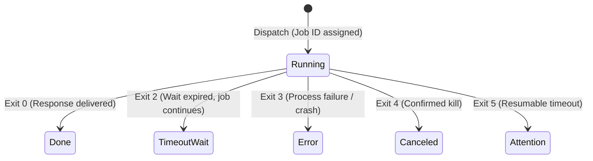

# SKILL: AGY_STAFF_DELEGATION_PRIME

## DOMAIN EXPERTISE
Model-facing CLI delegation architecture, progressive disclosure protocols, detached asynchronous worker lifecycles, and deterministic exit-code governance derived from the `agy-staff` specification.

## KEY TEXTS & CONCEPTS
- **Model-as-Caller Principle**: When an AI agent delegates to a subprocess or external CLI, design the interface for an LLM caller:
  - Deliver states as deterministic exit codes (0 = Done, 2 = Running, 3 = Error, 4 = Canceled, 5 = Attention).
  - Separate deliverable (stdout) from telemetry (stderr/logs).
  - Forbid busy polling loops; employ single blocking waits or asynchronous notifications.
- **Progressive Disclosure Ladder**:
  1. *Description*: When to use the role (always in context).
  2. *Instruction*: How to brief, run, and collect.
  3. *Dispatch*: Returns job ID and collection command.
  4. *Observation*: Bounded snapshot of recent tool activity on demand.
  5. *Deliverable*: Final synthesized report delivered upon completion.
- **Workspace State Preservation**:
  - Pre-audit working tree diff before running worker.
  - Inform worker of preexisting dirty files to prevent overwriting user work.
  - Require workers to operate in separate git worktrees when parallelizing modifications.

## INSTRUCTION

### 1. The 5 Core Delegation Personas
| Persona | Execution Stance | File System Authority |
|---|---|---|
| `ask` | Synchronous, tool-free second opinion | None (read-only reasoning) |
| `staffer` | General-purpose task execution | Unrestricted / scoped edits |
| `researcher` | Evidence-first inquiry, unverified claims isolated | Read-only (tracked files untouched) |
| `reviewer` | Severity-ranked findings & multi-angle challenge | Read-only (tracked files untouched) |
| `implementer` | Scoped, minimal diff adhering to repo conventions | Edits allowed, verifies before finish |

### 2. State & Exit Code Matrix

### 3. Verification & Acceptance
- The delegation harness never decides acceptance or retries automatically.
- The host agent evaluates the worker output against explicit acceptance criteria.

## VERSION
v0.1

## SEE ALSO
- `ANTIGRAVITY_CLI_BEST_PRACTICES_PRIME`
- `KARPATHY_COGNITIVE_COMPRESSION_PRIME`
- `COMPOUND_ENGINEERING_PRIME`
