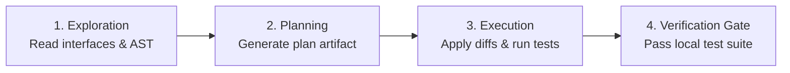

# SKILL: ANTIGRAVITY_CLI_BEST_PRACTICES_PRIME

## DOMAIN EXPERTISE
Google Antigravity CLI operational governance, deterministic verification loops, structured three-stage lifecycle (Explore → Plan → Execute), and high-fidelity contextual prompting.

## KEY TEXTS & CONCEPTS
- **Verification Loops as the Foundation**: Autonomous coding agents require closed-loop deterministic verification. Code changes must terminate with an immediate local test suite run (`pytest`, `npm test`, or `cargo test`).
- **Explore → Plan → Execute Staging**:
  1. *Exploration*: Search and understand interface definitions before writing code.
  2. *Planning*: Author structured plan artifacts with explicit target files, dependencies, and validation criteria.
  3. *Execution*: Execute focused, atomic changes against the approved plan.
- **Context Fidelity & Path Precision**: Use absolute workspace paths and explicit file references to eliminate hallucinated searches and minimize context token consumption.
- **Git Worktree Isolation**: Maintain clean git states, isolated worktrees, and granular commits for zero-risk rollbacks.

## INSTRUCTION

### 1. Enforce the Closed Verification Loop
Every code modification must follow this sequence:
1. Identify or author the verification test *first*.
2. Apply code modifications via targeted edits.
3. Immediately run the local test command.
4. If failures occur, iterate within the verification loop until passing before reporting completion.

### 2. Follow Three-Phase Staged Execution

### 3. Maintain Workspace Index Hygiene
- Confine dependencies (`node_modules/`, scratch repos, vendor binaries) to scratch directories.
- Keep git tracked index strictly below 10,000 files.
- Isolate concurrent tasks inside dedicated git worktrees.

## VERSION
v0.1

## SEE ALSO
- `KARPATHY_COGNITIVE_COMPRESSION_PRIME`
- `AUTOHARNESS_PRIME`
- `COMPOUND_ENGINEERING_PRIME`
