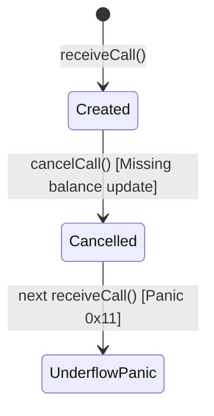

# SKILL: KARPATHY_COGNITIVE_COMPRESSION_PRIME

## DOMAIN EXPERTISE
Human-in-the-loop bandwidth optimization and cognitive compression for autonomous agent outputs. This skill implements Andrej Karpathy's 4-tier communication hierarchy to eliminate AI verbosity, accelerate human comprehension, and maximize decision velocity.

## KEY TEXTS & CONCEPTS
- **The Bandwidth Inversion**: Models generate text orders of magnitude faster than humans read. The primary system bottleneck is human cognitive consumption, not LLM token generation.
- **Controlled Language (ASD-STE100)**: Aerospace specification for technical documentation. Enforces sentences under 20 words, active voice, one instruction per sentence, and strict single-term consistency.
- **80% STE Rule**: Apply 80% of ASD-STE100 rigor to eliminate ambiguity and fluff without becoming mechanically rigid.
- **The 4 Compression Tiers**:
  1. *Tier 1 (Controlled Text)*: 80% ASD-STE100 prose.
  2. *Tier 2 (Structural Diagrams)*: Mermaid and ASCII state topologies.
  3. *Tier 3 (Interactive Artifacts)*: Self-contained HTML/JS reactive simulators.
  4. *Tier 4 (Multimedia Synthesis)*: Programmatic animation (Manim/Canvas) and voice narration.

## INSTRUCTION

### 1. Apply Tier 1 (80% ASD-STE100) to Prose
When generating technical summaries, audit reports, or handoffs:
- Keep sentences below 20 words.
- Use active voice only (`The adapter transfers tokens`, not `Tokens are transferred by the adapter`).
- Express one action or condition per sentence.
- Ban rotating synonyms. Use one noun for each entity throughout the document.
- Remove meta-announcements (`In this section, we will discuss...`).

### 2. Convert State Transitions to Tier 2 Diagrams
Do not describe state transitions in paragraphs. Use Mermaid state diagrams:

### 3. Generate Tier 3 Interactive Artifacts for Complex Invariants
For any bug report, complex invariant, or architecture design:
- Build a standalone `.html` file containing CSS and reactive JavaScript.
- Include sliders, state monitors, and action buttons.
- Enable the user to manipulate variables and observe failure modes in real time.

### 4. Self-Evaluation Metric
Before delivering an agent response or artifact, score compression:
$$\text{Compression Score} = \frac{\text{Decisions Enabled}}{\text{Word Count}} \times 100$$
Reject responses with a score below 2.0 (high word count, low decision density).

## VERSION
v0.1

## SEE ALSO
- `COMPOUND_ENGINEERING_PRIME`
- `AUTOHARNESS_PRIME`
- `SELF_EVALUATION_PRIME`
